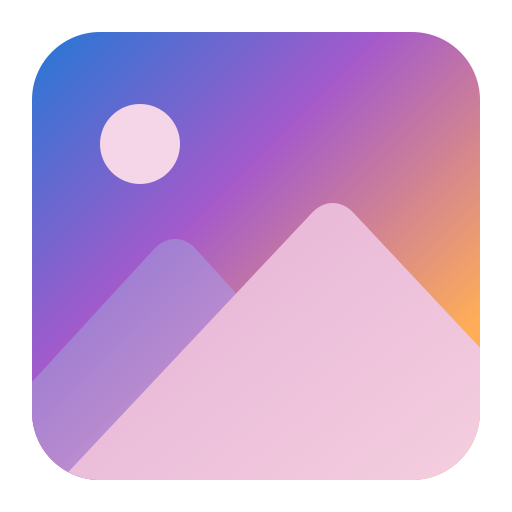
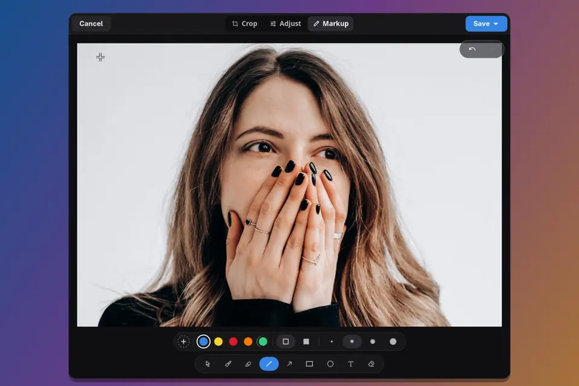

<p align="center">
  
</p>

<div align="center">

# Glance

**View and edit images on GNOME**

[](https://github.com/Replexo/Glance/releases/latest)
[](COPYING.md)
[](https://gtk.org)



</div>

Glance is an image viewer with an editor built in. Open a picture, mark it up, adjust its colours or crop it, and save, all in the same window. It is a fork of [Loupe](https://gitlab.gnome.org/GNOME/loupe), the GNOME image viewer, so browsing stays fast, sandboxed and touch-friendly.

## Features

### Viewing

Everything you know from Loupe: fast and sandboxed image loading, smooth zoom and gestures, image metadata, printing and setting a picture as the background.

### Markup

- Brush, highlighter, line, arrow, rectangle, ellipse and text tools.
- An eraser that rubs out markup where you drag.
- Preset and custom colours, four line widths and filled shapes.
- Select, move, resize and rotate anything you have drawn.
- Type text straight onto the picture, choose its font and size, and edit it again later.

### Adjust

Brightness, contrast, highlights, shadows and saturation, each on its own slider. Hold the compare button to see the original.

### Crop

Free or fixed aspect ratios, rotate, flip and resize.

### And more

- Undo and redo across every kind of edit.
- Zoom inside the editor for detailed work.
- **Save a Copy**, or **Replace Original** and move the old file to the trash.
- **Make Default Image Viewer** in the main menu opens every supported image type with Glance.

## Install

Glance is coming to Flathub. Until then, build and install the Flatpak from this repository:

```sh
git clone https://github.com/Replexo/Glance.git
cd Glance
flatpak-builder --user --install --install-deps-from=flathub build-flatpak build-aux/flatpak/io.github.Replexo.Glance.json
```

This needs `flatpak-builder` and the [Flathub remote](https://flathub.org/setup). You can also [build Glance natively](#build-from-source).

## Keyboard shortcuts

| Key | Action |
|---|---|
| <kbd>E</kbd> | Open the editor |
| <kbd>C</kbd> | Crop |
| <kbd>A</kbd> | Select, move and resize markup |
| <kbd>B</kbd> | Brush |
| <kbd>L</kbd> / <kbd>Shift</kbd>+<kbd>L</kbd> | Line / arrow |
| <kbd>R</kbd> / <kbd>O</kbd> | Rectangle / ellipse |
| <kbd>T</kbd> | Text |
| <kbd>E</kbd> (in the editor) | Eraser |
| <kbd>Shift</kbd> while drawing | Squares, circles and lines at 45° steps |
| <kbd>Ctrl</kbd>+<kbd>Z</kbd> / <kbd>Ctrl</kbd>+<kbd>Shift</kbd>+<kbd>Z</kbd> | Undo / redo |
| <kbd>Ctrl</kbd>+<kbd>S</kbd> / <kbd>Ctrl</kbd>+<kbd>Shift</kbd>+<kbd>S</kbd> | Replace original / save a copy |

All shortcuts are listed under **Keyboard Shortcuts** in the main menu.

## Build from source

You need GTK 4.20, libadwaita 1.8, libgweather 4, libseccomp, the glycin loaders and Rust 1.93 or newer.

```sh
meson setup builddir
ninja -C builddir
ninja -C builddir install
```

To build a development version with its own app ID, so it can sit next to an installed release:

```sh
meson setup builddir -Dprofile=dev -Dapp_id_suffix=.Devel
```


## Contributing

Bug reports and ideas are welcome in the [issue tracker](https://github.com/Replexo/Glance/issues). See [CONTRIBUTING.md](CONTRIBUTING.md) before opening a pull request.

## Credits

- Based on [Loupe](https://gitlab.gnome.org/GNOME/loupe) by Christopher Davis, Sophie Herold and the GNOME contributors.
- Icons from [MingCute Icons](https://www.mingcute.com/) (Apache-2.0) and [coolicons](https://github.com/krystonschwarze/coolicons) (MIT). See `data/COPYING.mingcute` and `data/COPYING.coolicons`.
- The set of markup tools follows [Gradia](https://github.com/AlexanderVanhee/Gradia).
- Translations come from the Loupe translators. Text added by Glance is in English for now.

## License

Glance is free software, released under the [GNU General Public License, version 3 or later](COPYING.md).
