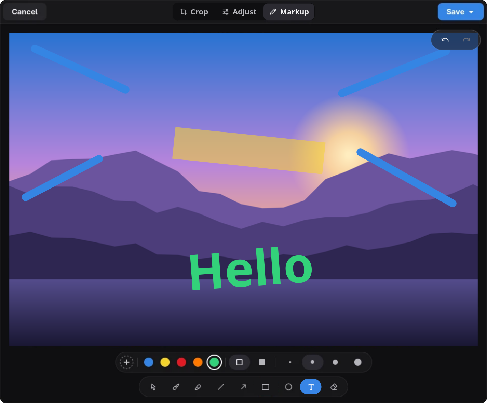

# Glance

An image viewer for GNOME with built-in editing. Glance is a fork of [Loupe](https://gitlab.gnome.org/GNOME/loupe), the GNOME image viewer, and adds tools to adjust, mark up, crop and resize images.



## Features

Everything Loupe does, including fast, sandboxed image loading, gestures, zoom, metadata and printing, plus:

- **Markup:** brush, highlighter, line, arrow, rectangle, ellipse and text, an eraser, preset and custom colours, line widths and filled shapes. Shapes can be selected, moved, resized and rotated, and text can be edited after it is placed.
- **Adjust:** brightness, contrast, highlights, shadows and saturation, with a hold-to-compare button.
- **Crop:** free or fixed aspect ratios, rotate, flip and resize.
- Undo and redo across all edits, and zoom inside the editor.
- **Saving:** save a copy, or replace the original and move it to the trash.

## Keyboard shortcuts in the editor

| Key | Action |
|---|---|
| C | Crop |
| A | Select, move and resize markup |
| B | Brush |
| L / Shift+L | Line / arrow |
| R / O | Rectangle / ellipse |
| T | Text |
| E | Eraser |
| Shift while drawing | Perfect squares and circles, lines at 45° steps |
| Ctrl+Z / Ctrl+Shift+Z | Undo / redo |

## Install

Download the Flatpak bundle from the [latest release](https://github.com/Replexo/Glance/releases/latest) and install it:

```sh
flatpak install glance-1.0.flatpak
```

## Build from source

Glance needs GTK 4.20, libadwaita 1.8, libgweather 4, libseccomp, glycin loaders and Rust 1.93 or newer.

```sh
meson setup builddir
ninja -C builddir
ninja -C builddir install
```

A development build with its own app ID:

```sh
meson setup builddir -Dprofile=dev -Dapp_id_suffix=.Devel
```

To build the Flatpak:

```sh
flatpak-builder --user --install build-flatpak build-aux/flatpak/io.github.Replexo.Glance.json
```

## Credits

- Based on [Loupe](https://gitlab.gnome.org/GNOME/loupe) by Christopher Davis, Sophie Herold and the GNOME contributors.
- Icons: [MingCute Icons](https://www.mingcute.com/), Apache-2.0 (`data/COPYING.mingcute`), and the brightness, contrast, flip and highlighter icons from [coolicons](https://github.com/krystonschwarze/coolicons), MIT (`data/COPYING.coolicons`).
- The set of markup tools follows [Gradia](https://github.com/AlexanderVanhee/Gradia).
- Translations come from the Loupe translators. Strings added by Glance are English only for now.

## License

Glance is free software under the GNU General Public License, version 3 or later. See [COPYING.md](COPYING.md).
