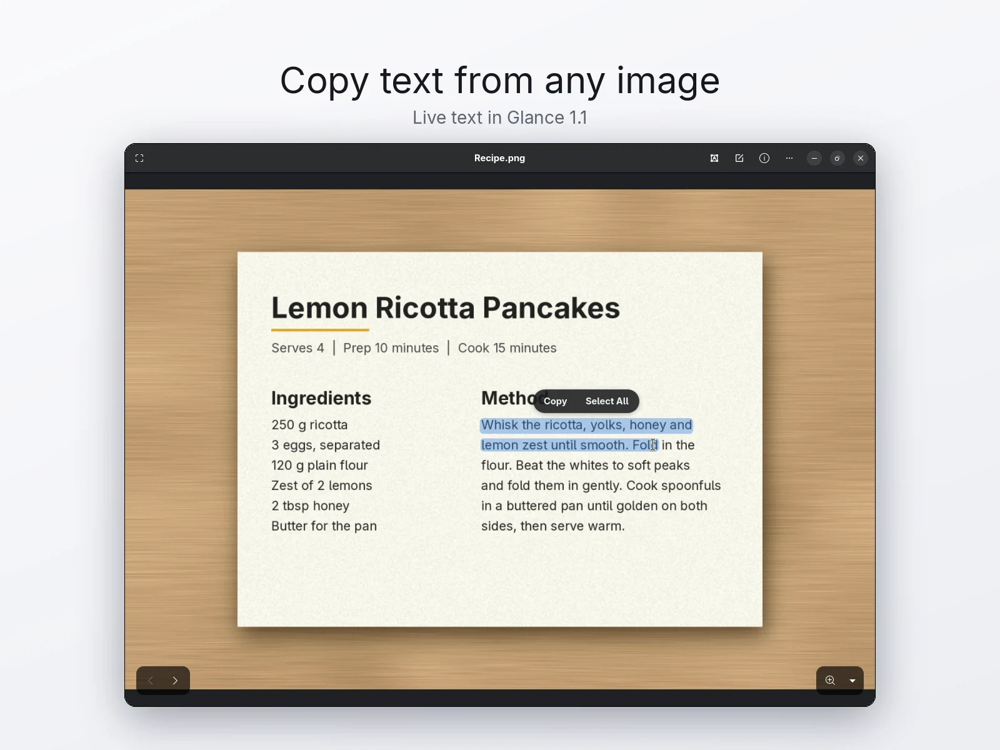

<p align="center">
  
</p>

<div align="center">

# Glance

**Image viewer and photo editor for Linux**

[](https://github.com/Replexo/Glance/releases/latest)
[](COPYING.md)
[](https://gtk.org)


</div>

Glance is a fast image viewer and photo editor for Linux and GNOME. Open a picture, annotate it, adjust its colours, crop it, copy the text in it, and save, all in the same window. It is a fork of [Loupe](https://gitlab.gnome.org/GNOME/loupe), the GNOME image viewer, so browsing stays fast, sandboxed and touch-friendly.

Glance runs on any Linux desktop and comes as a Flatpak, an AppImage, and packages for Debian and Ubuntu, Fedora and Arch Linux.

## Features

### Viewing

Everything you know from Loupe: fast and sandboxed image loading, smooth zoom and gestures, image metadata, printing and setting a picture as the background.

### Markup

- Brush, highlighter, line, arrow, rectangle, ellipse and text tools.
- An eraser that rubs out markup where you drag.
- Preset and custom colours, four line widths and filled shapes.
- Select, move, resize and rotate anything you have drawn.
- Type text straight onto the picture, choose its font and size, and edit it again later.

### Adjust

Brightness, contrast, highlights, shadows and saturation, each on its own slider. Hold the compare button to see the original.

### Crop

Free or fixed aspect ratios, rotate, flip and resize.

### Live text (OCR)

Select and copy text straight from any image: screenshots, scanned pages, photos of signs, screens and documents. Glance finds the text by itself with [Tesseract](https://github.com/tesseract-ocr/tesseract), also when it is turned, tilted or slightly curved, and everything stays on your computer.

It reads English, Spanish, French, German, Portuguese, Russian, Polish and Turkish, using your device language together with English.



### And more

- Undo and redo across every kind of edit.
- Zoom inside the editor for detailed work.
- **Save a Copy**, or **Replace Original** and move the old file to the trash.
- **Make Default Image Viewer** in the main menu opens every supported image type with Glance.
- The Flatpak and AppImage can check for new versions from the main menu.

### Languages

Glance is fully translated into Spanish, German, French, Brazilian Portuguese, Russian, Polish and Turkish. The viewer is also translated into the other 52 languages of Loupe.

## Install

Download the file for your system from the [latest release](https://github.com/Replexo/Glance/releases/latest):

| System | File | Install |
|---|---|---|
| Any Linux (Flatpak) | [`Glance-1.1-x86_64.flatpak`](https://github.com/Replexo/Glance/releases/latest/download/Glance-1.1-x86_64.flatpak) | `flatpak install --user Glance-1.1-x86_64.flatpak` |
| Any Linux (AppImage) | [`Glance-1.1-x86_64.AppImage`](https://github.com/Replexo/Glance/releases/latest/download/Glance-1.1-x86_64.AppImage) | `chmod +x Glance-1.1-x86_64.AppImage`, then run it |
| Ubuntu 25.10 and newer | [`glance_1.1_amd64.deb`](https://github.com/Replexo/Glance/releases/latest/download/glance_1.1_amd64.deb) | `sudo apt install ./glance_1.1_amd64.deb` |
| Fedora 43 and newer | [`glance-1.1-1.fc43.x86_64.rpm`](https://github.com/Replexo/Glance/releases/latest/download/glance-1.1-1.fc43.x86_64.rpm) | `sudo dnf install ./glance-1.1-1.fc43.x86_64.rpm` |
| Arch Linux | [`glance-1.1-1-x86_64.pkg.tar.zst`](https://github.com/Replexo/Glance/releases/latest/download/glance-1.1-1-x86_64.pkg.tar.zst) | `sudo pacman -U glance-1.1-1-x86_64.pkg.tar.zst` |

The Flatpak uses the GNOME 51 runtime, which Flatpak downloads from [Flathub](https://flathub.org/setup) if you don't have it yet. Glance is coming to Flathub itself soon, with automatic updates. You can check your download against `SHA256SUMS` on the release page.

To build it yourself instead, see [Build from source](#build-from-source).

## Keyboard shortcuts

| Key | Action |
|---|---|
| <kbd>E</kbd> | Open the editor |
| <kbd>C</kbd> | Crop |
| <kbd>A</kbd> | Select, move and resize markup |
| <kbd>B</kbd> | Brush |
| <kbd>L</kbd> / <kbd>Shift</kbd>+<kbd>L</kbd> | Line / arrow |
| <kbd>R</kbd> / <kbd>O</kbd> | Rectangle / ellipse |
| <kbd>T</kbd> | Text |
| <kbd>E</kbd> (in the editor) | Eraser |
| <kbd>Shift</kbd> while drawing | Squares, circles and lines at 45° steps |
| <kbd>Ctrl</kbd>+<kbd>Z</kbd> / <kbd>Ctrl</kbd>+<kbd>Shift</kbd>+<kbd>Z</kbd> | Undo / redo |
| <kbd>Ctrl</kbd>+<kbd>S</kbd> / <kbd>Ctrl</kbd>+<kbd>Shift</kbd>+<kbd>S</kbd> | Replace original / save a copy |

All shortcuts are listed under **Keyboard Shortcuts** in the main menu.

## Build from source

You need GTK 4.20, libadwaita 1.8, libgweather 4, libseccomp, the glycin loaders, Tesseract 5 with Leptonica, and Rust 1.93 or newer.

```sh
meson setup builddir
ninja -C builddir
ninja -C builddir install
```

To build and install the Flatpak:

```sh
flatpak-builder --user --install --install-deps-from=flathub build-flatpak build-aux/flatpak/io.github.Replexo.Glance.json
```

To build a development version with its own app ID, so it can sit next to an installed release:

```sh
meson setup builddir -Dprofile=dev -Dapp_id_suffix=.Devel
```


## Contributing

Bug reports and ideas are welcome in the [issue tracker](https://github.com/Replexo/Glance/issues). See [CONTRIBUTING.md](CONTRIBUTING.md) before opening a pull request.

## Credits

- Based on [Loupe](https://gitlab.gnome.org/GNOME/loupe) by Christopher Davis, Sophie Herold and the GNOME contributors.
- Icons from [MingCute Icons](https://www.mingcute.com/) (Apache-2.0) and [coolicons](https://github.com/krystonschwarze/coolicons) (MIT). See `data/COPYING.mingcute` and `data/COPYING.coolicons`.
- The set of markup tools follows [Gradia](https://github.com/AlexanderVanhee/Gradia).
- Text recognition by [Tesseract](https://github.com/tesseract-ocr/tesseract) (Apache-2.0).
- Translations of the viewer come from the Loupe translators.

## License

Glance is free software, released under the [GNU General Public License, version 3 or later](COPYING.md).
